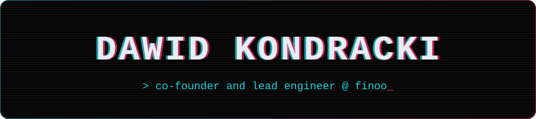

 

---

### 🚀 What I'm building

<table>
  <tr>
    <td width="50%" valign="top">
      <h4>🏦 finoo</h4>
      <code>fintech</code> <code>Open Banking</code>
      
Credit offer matching platform, 12 domain services.

    </td>
    <td width="50%" valign="top">
      <h4>🛰️ Kyrion · KyrionLabs</h4>
      <code>desktop</code> <code>multi-agent</code>
      
Coding with a swarm of AI agents in one conversation.

    </td>
  </tr>
  <tr>
    <td width="50%" valign="top">
      <h4>⚙️ <a href="https://github.com/CRONOSS-Solaris/agent-pipeline-pack">agent-pipeline-pack</a></h4>
      <code>open source</code> <code>MIT</code>
      
<b>plan → implement → review → QA → merge</b>

    </td>
    <td width="50%" valign="top">
      <h4>🧐 finoo-critic</h4>
      <code>plugin</code> <code>PL / EN</code>
      
Reviewer agent for code, plans and docs.

    </td>
  </tr>
</table>

---

### 🛠️ Tech stack

**Backend** 

**Data & messaging** 

**Frontend & desktop** 

**DevOps & cloud** 

**AI tooling** 

---

### 📈 GitHub activity

